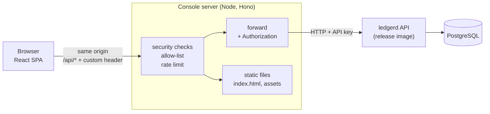

# Design Document — ledgerd console

## 1. Overview

The console is three things in one repository:

1. a **single-page application** (React) that people use;
2. a **console server** (a small Node program) that serves the application and is the
   only thing that talks to ledgerd, holding the API key so the browser never sees it;
3. **tests and tooling** that keep both honest: generated API types, a Failure Lab that is
   itself tested, end-to-end tests against a real ledgerd, and security tests that send
   hostile requests and assert the refusal.

### Key decisions

| # | Decision | Rationale | Cost |
|---|---|---|---|
| D1 | A **console server** holds the API key and forwards a fixed allow-list of calls | A key in browser code is public. Same-origin forwarding also removes CORS entirely | One more process to run and secure |
| D2 | The server is **Hono** on Node, bundled with esbuild | Tiny, typed, standard `Request`/`Response`; `app.request()` tests the whole server in-process, which makes the security tests cheap and fast | Smaller ecosystem than Express/Fastify; rate limiting and the allow-list are written by hand (about 100 lines, fully tested) |
| D3 | **Two different checks stop cross-site abuse**: validate `Host` and `Origin`, and require a custom header on every non-`GET` | A console that holds a financial API key is reachable by any web page the user visits (CSRF, DNS rebinding). A custom header cannot be sent cross-site without a CORS preflight, which the server never grants | Every call must go through the one API client that adds the header |
| D4 | **Money is `bigint` end to end**; amounts are strings on the wire | Same reason as ledgerd: `number` loses integers above 2^53. A lint rule forbids `parseFloat`, and property tests cover parse/format | A formatting layer is needed for display |
| D5 | **API types are generated** from ledgerd's `openapi.yaml`; **Zod schemas** validate responses at runtime; a compile-time check ties the two together | The contract stays the single source of truth, and a wrong shape throws instead of reaching the UI | Two descriptions of each shape (checked against each other by the compiler) |
| D6 | The **Failure Lab** is a list of pure async functions over an injected API, recording every request/response | Testable against a fake and against a real ledgerd; the UI renders the recording generically | Each scenario also needs its expected outcome written down |
| D7 | **Charts are small custom SVG components**, not a chart library | Only bar charts of a dozen numbers are needed; a library adds weight and inline styles that the strict Content Security Policy blocks; custom components can carry their own accessible table | Less flexible than a library (acceptable here) |
| D8 | Pages are **route-level code-split**, and state lives in the **URL** where it should be shareable | Smaller first load; an `as_of` instant or a filter can be bookmarked | Slightly more routing code |
| D9 | **No form library**: forms are controlled components, and the transaction builder is a pure reducer | The builder logic (totals, balance check) is plain data and is property-tested; fewer dependencies | A bit of repeated field wiring (wrapped in one `Field` component) |
| D10 | **Native `<dialog>`** for confirmations | Built-in focus trapping, Escape handling and accessibility semantics | None that matters here |
| D11 | The console is **distributed with ledgerd's release images** (`ghcr.io/cmdevrg/ledgerd` and `ledgerd-postgres`, pinned by tag and digest) | One command can start the whole stack without building Go code or copying ledgerd's database setup | ledgerd must publish images (a ledgerd task, release 0.2.0) |
| D12 | **Playwright** end-to-end tests run against that real stack and also produce the screenshots | The only test that proves the pieces work together, and the README images cannot go stale | Slower; needs a browser and system libraries in CI |

## 2. Architecture



- The browser only ever contacts the console server's origin. `GET /` and `/assets/*`
  return the built application; `/api/*` is forwarded to ledgerd with the key added.
- Everything under `/api` is ledgerd's path with `/api` removed: `/api/v1/accounts`
  becomes `/v1/accounts`, and `/api/readyz` becomes `/readyz`.

### Development and production

| | Production (`npm start`, the container) | Development (`npm run dev`) |
|---|---|---|
| Static files | served by the console server from `dist/` | served by Vite with hot reload on `:5173` |
| `/api` | handled by the console server on `:8787` | Vite forwards `/api` to the console server running with `tsx watch` |
| Security checks | all enforced | all enforced (the allowed hosts and origins include `localhost:5173`) |
| API key | read from the server's environment | read from the server's environment |

Both modes use the same server code, so the key handling developers see is the one that ships.

## 3. Console server

### Request pipeline

Middleware run in this order; the first that refuses ends the request.

1. **Request id** (accept a well-formed `X-Request-Id`, else generate), added to every response and log line.
2. **Host check**: the `Host` header must be in the allowed hosts, else `421 Misdirected Request`. (Stops DNS rebinding.)
3. **Rate limit**: token bucket per client address, 50 requests per second sustained with a burst of 200, else `429` with `Retry-After`. (Generous enough for the Lab's concurrent scenario; the limit exists to stop a runaway page, not to meter a person.)
4. **Security headers** on every response: `Content-Security-Policy` (below), `X-Content-Type-Options: nosniff`, `Referrer-Policy: no-referrer`, `X-Frame-Options: DENY`, `Cross-Origin-Opener-Policy: same-origin`, and `Cache-Control: no-store` for `/api`.
5. For `/api/*` only:
   1. **Allow-list**: `(method, path)` must match a route in the table below, else `404` (unknown path) or `405` (known path, wrong method, with `Allow`). ledgerd is not contacted.
   2. **Cross-site defences** for every method except `GET` and `HEAD`: the request must carry `X-Ledgerd-Console: 1`, and if it carries an `Origin` it must be in the allowed origins; if it carries `Sec-Fetch-Site` it must not be `cross-site`. Otherwise `403`.
   3. **Body limit** (64 KiB; ledgerd's own limit is 1 MiB, the console never needs that much) and, when a body is present, `Content-Type: application/json`.
   4. **Forward** (below).
6. Everything else: a file from `dist/` if it exists, otherwise `index.html` (so deep links like `/accounts/…` work). A path that looks like a file but does not exist (`/assets/x.js`) returns `404`, not the HTML.

### Allow-list

| Method | Path (browser side) | Used by |
|---|---|---|
| GET | `/api/readyz` | connection status |
| GET | `/api/v1/accounts` | account list, lab count |
| POST | `/api/v1/accounts` | create account, lab |
| GET | `/api/v1/accounts/{id}` | account page |
| GET | `/api/v1/accounts/{id}/balance` | balance, as-of |
| GET | `/api/v1/accounts/{id}/postings` | history |
| POST | `/api/v1/transactions` | builder, lab |
| GET | `/api/v1/transactions/{id}` | transaction page |
| POST | `/api/v1/transactions/{id}/reverse` | reversal, lab |
| POST | `/api/v1/reconciliations` | reconciliation |

A test compares this table with the `paths` of the generated types, so a new ledgerd
endpoint is never exposed by accident and a removed one is noticed. `/healthz` and
`/readyz` of the console server itself are separate and not forwarded.

### Forwarding rules

- Request headers sent to ledgerd: `Accept`, `Content-Type`, `Idempotency-Key`, `X-Request-Id`, plus `Authorization: Bearer <key>` added by the server. **Nothing else**, in particular no cookies.
- Response headers returned to the browser: `Content-Type`, `Location` (with `/api` prepended), `Idempotent-Replayed`, `X-Request-Id`, `Retry-After`, `Allow`. **Nothing else.**
- If ledgerd answers `401` (the server's key is wrong), the browser receives `502` with a problem document `console_misconfigured`; ledgerd's `401` is never relayed, because the browser could not fix it and the cause (a bad server configuration) is logged.
- If ledgerd cannot be reached or times out: `504` with the problem document `upstream_unavailable`. The timeout is 30 s, and 120 s for reconciliation.
- ledgerd's problem documents and success bodies pass through unchanged. The browser validates them with Zod.

### Content Security Policy

```
default-src 'self'; script-src 'self'; style-src 'self'; img-src 'self' data:;
font-src 'self'; connect-src 'self'; object-src 'none'; base-uri 'none';
form-action 'self'; frame-ancestors 'none'
```

No inline script or style is needed: Vite emits external files, Tailwind compiles to a
stylesheet, and charts are SVG elements styled with classes. A test fails if the built
`index.html` contains an inline script or style.

### Configuration

| Variable | Default | Meaning |
|---|---|---|
| `LEDGERD_URL` | `http://127.0.0.1:8085` | Base URL of ledgerd |
| `LEDGERD_API_KEY` | required | Added to forwarded requests; at least 16 characters; never logged or sent to the browser |
| `CONSOLE_ADDR` | `127.0.0.1:8787` | Listen address (loopback by default) |
| `CONSOLE_ALLOWED_HOSTS` | `localhost:8787,127.0.0.1:8787` | Accepted `Host` values |
| `CONSOLE_ALLOWED_ORIGINS` | `http://localhost:8787,http://127.0.0.1:8787` | Accepted `Origin` values |
| `CONSOLE_LOG_LEVEL` | `info` | |

Configuration errors are reported all at once and never print the key (the key is held
in a wrapper type that prints as `[REDACTED]`, the same idea as in ledgerd).

### Other server behaviour

- JSON logs: request id, method, path (no query string), status, duration, and whether the call was forwarded. Never headers, bodies or the key.
- `GET /healthz` (process alive) and `GET /readyz` (can reach ledgerd's `/readyz`) for container health checks. These are the console server's own endpoints, not forwarded.
- Graceful shutdown on SIGTERM: stop accepting, finish in-flight requests for up to 10 s, exit.
- The build bundles the server with esbuild into one file and runs it on a distroless Node image as a non-root user with a read-only filesystem.

## 4. The application

### Structure

```
src/
  app/            router, layout, providers, error boundary
  api/            http client, zod schemas, generated schema.d.ts, query hooks
  money/          parse, format, scales (pure; property-tested)
  features/
    status/       readiness indicator
    accounts/     list, create form, detail, history, as-of
    transactions/ builder (reducer), result view, idempotency panel, reversal
    lab/          scenarios (pure), runner UI, exchange viewer
    reconciliation/
    benchmark/    data, charts, tables
    settings/     display scales, theme
  ui/             Button, Field, Table, Badge, Dialog, CopyText, Amount, Time, LiveRegion, SvgBarChart
  test/           MSW server, render helper, factories typed by the generated schema
server/           the console server (separate tsconfig, runs on Node)
e2e/              Playwright tests and screenshot script
scripts/          dev runner, k6-to-benchmark importer, bundle secret scan, traceability check
data/benchmark.json
```

### Routes

| Path | Page | Notes |
|---|---|---|
| `/` | Overview | status, counts, shortcuts |
| `/accounts` | Account list and create form | filter state in the URL (`?code=&currency=`) |
| `/accounts/:id` | Account detail | `?as_of=` in the URL; history with "load more" |
| `/transactions/new` | Builder | |
| `/transactions/:id` | Transaction | reverse button |
| `/lab` | Failure Lab | scenario list, results |
| `/reconciliation` | Reconciliation | |
| `/benchmark` | Benchmark results | |
| `/settings` | Display scales, theme | local only |

Each page module is loaded on demand. Unknown routes show a 404 page with navigation.

### Data layer

- **One API client** (`api/http.ts`) is the only code that calls `fetch`. It prefixes `/api`,
  adds `X-Ledgerd-Console: 1` to non-`GET` calls, applies a per-call timeout (30 s, 130 s
  for reconciliation), and turns every outcome into either a validated value or an `ApiError`
  of kind `refused` (a problem document), `busy` (503), `network`, or `unexpected` (a body
  that does not match the schema).
- **Zod schemas** (`api/schemas.ts`) describe each response. Amount fields are validated as
  digit strings and converted to `bigint` at the edge. A compile-time check
  (`Expect<Equal<z.input<typeof accountSchema>, components['schemas']['Account']>>`) fails
  the type check if a schema and the generated contract types disagree.
- **TanStack Query** holds server state. Query keys: `['readiness']`, `['accounts', filters]`,
  `['account', id]`, `['balance', id, asOf]`, `['postings', id]` (infinite), `['transaction', id]`.
  After a successful write, the affected `account`, `balance`, `postings` and `accounts` keys
  are invalidated. Account pages poll every 10 s; the readiness indicator every 10 s.
- **Cursor lists** use `useInfiniteQuery`; pages are appended, never replaced, so a reader
  does not lose their place when more are loaded.

### Money

`money/` has no React in it:

- `parseAmount(text, scale): Result<bigint, MoneyError>` accepts `1` and `1.50`; it rejects signs, exponents, thousands separators, padding, a comma decimal separator, too many decimals, zero, and values above 10^30 minor units, and the error says which.
- `formatAmount(minor, scale, options)` gives the exact digits, `100.00`, with a sign for negatives.
- `defaultScale(currency)`: USD and EUR 2, JPY 0, USDT and USDC 6, BTC 8, ETH 18, otherwise 2; overridable in settings.
- An `<Amount>` component renders money with its currency and a raw-units toggle; negatives get an explicit minus sign and a text label, not colour alone.
- Property tests: for any `bigint` in 1..10^30 and any scale 0..18, `parse(format(x)) === x`; and an architecture test fails if any file in `money/` calls `Number`, `parseFloat`, `parseInt` or `Math` on an amount.

### Transaction builder

State is a plain object `{ description, rows: [{ id, accountId, direction, amountText }], key }`
changed by a pure reducer (`addRow`, `removeRow`, `setField`, `simpleTransfer`). Selectors
compute, per currency, total debits, total credits and the difference with `bigint`
arithmetic, and whether the transaction is balanced. The reducer and selectors are
property-tested (random rows: totals equal the sum of what was entered; the balance verdict
agrees with an independent computation). The submit handler builds the request, sets the
`Idempotency-Key`, and keeps the *exact* request so "send the same request again" reuses it
byte for byte.

### Error presentation

`ApiError` kinds map to one component each. A refusal shows code, title, detail and the
request id with a copy button, and field errors are attached to the rows or fields they name
(`postings[1].amount` becomes row 2's amount). A busy error shows the suggested wait. A
network error says the console server or ledgerd is unreachable and offers a retry. An
unexpected error says the answer was not understood and shows the request id. Errors during
React rendering are caught by an error boundary per route.

### Accessibility patterns

- One `<h1>` per page, a `<title>` per route, landmarks (`header`, `nav`, `main`).
- `Field` renders a `<label>`, the control, a hint and the error with `aria-describedby` and `aria-invalid`; an error summary with `role="alert"` appears on a failed submit and focus moves to it.
- A global polite live region announces readiness changes and operation results; the status badge uses `role="status"`.
- Tables use real `<table>` semantics with captions; wide ones scroll inside a focusable container.
- Dialogs are native `<dialog>` opened with `showModal()`, returning focus to the opener.
- Motion is limited to short CSS transitions, disabled under `prefers-reduced-motion`.
- axe runs in every component test and in the end-to-end tests; any violation fails the test.

### Appearance

Tailwind with `dark:` variants following the OS, plus a manual override stored in local
storage and applied before first paint by a tiny external script file (not inline, so the
CSP still holds). Identifiers (UUIDs, cursors) use a `CopyText` component: truncated in the
middle, full value in the title, copyable.

## 5. Failure Lab

```ts
interface Exchange {            // one HTTP round trip, as recorded
  method: string; path: string; headers: Record<string, string>; body?: unknown
  status: number; responseHeaders: Record<string, string>; responseBody: unknown; ms: number
}
interface LabApi { send(request: LabRequest): Promise<Exchange> }   // does not throw on HTTP errors

interface Step {
  title: string; explanation: string
  exchanges: Exchange[]
  checks: { label: string; expected: string; actual: string; ok: boolean }[]
}
interface ScenarioResult {
  id: ScenarioId
  verdict: 'as-designed' | 'unexpected' | 'could-not-run'
  steps: Step[]
}
type Scenario = { id: ScenarioId; title: string; summary: string; run(api: LabApi, ids: IdSource): Promise<ScenarioResult> }
```

- The browser never has the API key, so a recorded exchange cannot contain it; an architecture test asserts that no recorded header is `authorization`.
- A scenario is a function. The UI runs it, shows each step (request, response, checks) and the verdict, which is `as-designed` only if every check passed. A network failure gives `could-not-run`, never `as-designed`.
- Lab accounts are created with codes `lab-<run id>-<name>`; the Lab counts them through `GET /v1/accounts?code_prefix=lab-`.

| Scenario | What it does | Passes if |
|---|---|---|
| a. Overdraft | fund a protected wallet with 100, withdraw 101 | the withdrawal is `422 insufficient_funds` and the balance is still 100 |
| b. Retry | send a deposit twice with the same key | the second answer has `Idempotent-Replayed: true`, the same transaction id, and the balance changed once |
| c. Key reuse | same key, different amount | `422 idempotency_key_reuse`, balance unchanged |
| d. Unbalanced | debit 100, credit 99 | `422 unbalanced_transaction`, nothing recorded |
| e. Number amount | `"amount": 100` as a JSON number | `422 validation_error` naming `postings[0].amount` |
| f. Precision | deposit 2^53+1, 2^63 and 10^30; then 10^30+1 | balances equal the exact digits; the last is refused |
| g. Double reversal | reverse a transaction twice | the first `201`, the second `409 already_reversed` |
| h. Concurrency | 30 withdrawals of 10 against a balance of 100, sent in parallel | exactly 10 accepted, 20 refused, final balance 0 |

Browsers limit parallel connections to one host (6 for HTTP/1.1); the concurrency scenario
reports the highest number of requests it observed in flight and says so.

Testing: each scenario runs against (1) a fake in-memory ledger that implements the rules
(a unit test, also run with deliberately wrong behaviour to prove each check can fail), and
(2) the real ledgerd in the end-to-end suite.

## 6. Benchmark view

- `data/benchmark.json` has `{ source: {ledgerdCommit, date}, environment: {...}, runs: [{virtualUsers, scenario, transfersPerSecond, p50, p90, p95, p99, maxMs, failedPercent}] }`.
- A Zod schema validates it when the module loads and in `npm run verify` (`scripts/check-benchmark.ts`), so a bad file fails the build and cannot reach a user.
- `scripts/import-k6.ts` converts ledgerd's `bench/results/summary.json` and `environment.txt` into that file. Updating the page is: run `make bench` in ledgerd, run the importer, review the diff.
- Charts are `SvgBarChart` components: grouped bars by virtual users for throughput and for p95 latency, each with `role="img"`, a title and description, and a visible `<table>` holding the same numbers.
- The text next to the charts says what *spread* and *hot account* mean and that the numbers come from one laptop.

## 7. Testing strategy

| Layer | Tool | What it proves |
|---|---|---|
| Pure logic | Vitest + fast-check | money parse/format, builder totals, scenario checks, error classification |
| Components | Vitest + Testing Library + MSW + axe-core | each page's behaviour, error states, keyboard use and accessibility, with the API mocked and any unmocked request failing the test |
| Console server | Vitest (node) with `app.request()` and a fake ledgerd | allow-list, header policy, Host/Origin/CSRF refusals, rate limit, size limit, timeouts, 401 translation, `Location` rewriting, key never present in responses or logs |
| Build | scripts in `npm run verify` | no inline script or style in `index.html`; the configured key does not appear in the bundle; benchmark data valid; generated types current and compile |
| End to end | Playwright + `@axe-core/playwright` against the real stack | the whole flow in a real browser; every Lab scenario against real ledgerd; screenshots |
| Dependencies | `npm audit` | no high-severity advisory in production dependencies |

Mocks are built with factories typed by the generated schema types, so a renamed or retyped
field breaks the compile. Coverage is reported for the client and the server; the threshold
starts at 85% of statements for `src/money`, the feature logic and `server`, and is raised,
never lowered. The traceability matrix and its checker follow ledgerd's.

## 8. Build, packaging and CI

- `npm run build`: type check, build the SPA to `dist/`, bundle the server to `dist-server/`, then run the secret scan (a throwaway build with a canary key checks that the key string is absent from every emitted file) and the inline-script check.
- Docker: multi-stage; the runtime image is a distroless Node image running as non-root with a read-only root filesystem; base images pinned by digest.
- `docker-compose.yml`: `postgres` and `ledgerd` (release images, pinned by tag and digest), a one-shot migrate, and `console`. `make up` generates `.env` with random secrets, as in ledgerd, then starts everything and waits for health.
- CI (GitHub Actions, actions pinned by SHA): verify (types, lint, format, tests, build, scans), audit, then the end-to-end job (compose stack, Playwright, screenshots as an artifact).
- Dependabot for npm, Actions and Docker.

## 9. Limitations (to be stated in the README)

- Local-first: the console has no login of its own. Anyone who can reach the console server can use the ledger through it. It listens on loopback by default for that reason.
- One ledgerd instance; no multi-user collaboration; polling instead of push updates.
- The Lab's concurrency is bounded by the browser's connection limit.
- Display scales are a presentation setting; the ledger has no notion of decimals.
- Benchmark data is a snapshot from one machine, not live.

## 10. What this needs from ledgerd

- `GET /v1/accounts` (specified in `ledgerd/.kiro/specs/account-listing`, release 0.2.0).
- Release images on GHCR (same specification, release 0.2.0).
- Nothing else: every other call exists in 0.1.0.
